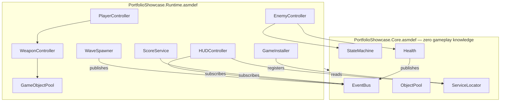
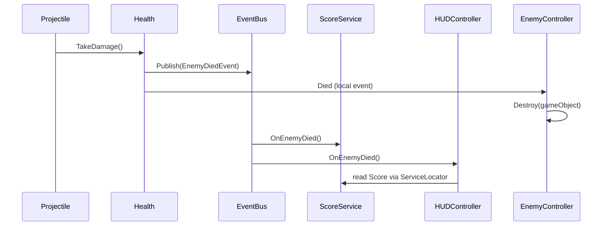

# Arena Systems

A small top-down arena-survival slice built to demonstrate **architecture**, not content volume: an event bus, a generic finite state machine, an object pool, a lightweight service locator, data-driven design via ScriptableObjects, assembly-boundary enforced layering, and a real EditMode unit test suite.

The gameplay is intentionally minimal (one weapon, two data-driven enemy variants, three waves). The point of this repo is the *shape* of the code — how systems talk to each other, what's decoupled from what, and how much of it can be tested without opening the Editor.

## What this demonstrates

| Area | Where |
|---|---|
| Event-driven decoupling (pub/sub) | `Core/Events/EventBus.cs` |
| Generic, engine-agnostic object pooling | `Core/Pooling/ObjectPool.cs`, `GameObjectPool.cs` |
| Generic finite state machine | `Core/FSM/StateMachine.cs`, used by `Gameplay/Enemies/States/*` |
| Composition root / service locator | `Installers/GameInstaller.cs`, `Core/DI/ServiceLocator.cs` |
| Data-driven design (ScriptableObjects) | `Data/EnemyData.cs`, `WeaponData.cs`, `WaveData.cs` |
| Interface-based combat (no type-checking chains) | `Core/Combat/IDamageable.cs`, `Health.cs` |
| Assembly definitions enforcing layering | `PortfolioShowcase.Core.asmdef`, `PortfolioShowcase.Runtime.asmdef` |
| Unit tests (EditMode, no scene required) | `Tests/EditMode/*` |
| Editor tooling: demo scene generated from code | `Editor/DemoSceneBuilder.cs` |

## Architecture

Two runtime assemblies, one direction of dependency:

`Core` has no idea `Enemy`, `Wave`, or `HUD` exist. It only knows about events, pools, states, and health — the same four systems would carry over unchanged into a completely different game. That boundary is enforced by the Unity compiler via `.asmdef` files, not just convention: `Core` cannot accidentally reference `Runtime` even if someone tries.

### Event flow example (an enemy dying)

Neither `ScoreService` nor `HUDController` has a reference to the enemy, the projectile, or each other.

## Deliberate trade-offs (and why)

Being upfront about scope decisions is part of the point of this repo:

- **Projectiles are pooled; enemies are not.** Projectiles spawn dozens of times per second — the classic case pooling exists for. Enemies spawn a handful of times per wave and live for seconds; pooling them would add bookkeeping for no measurable benefit. Pooling everything indiscriminately is a common over-engineering mistake — this repo pools what actually churns.
- **`ServiceLocator` instead of a DI framework.** On a real team project I'd reach for Zenject/VContainer for constructor injection and lifetime scopes. Here, a ~40-line service locator with a single composition root (`GameInstaller`) demonstrates the same discipline (one place things get wired up) without a package dependency.
- **The demo scene is generated from code.** Unity's scene/prefab YAML is GUID-dependent and unreviewable in a diff, so every wiring decision lives in one readable editor script instead: `Editor/DemoSceneBuilder.cs` (**Tools > Showcase > Build Demo Scene**). It builds the arena, prefabs, materials, and ScriptableObject data, and re-running it updates assets in place so GUIDs stay stable. The generated output is committed too, so the project is playable straight after cloning.
- **Classic Input Manager, not the Input System package.** Keeps the project dependency-free for review.

## Running the tests

Open **Window > General > Test Runner > EditMode** and press **Run All**. All ~19 tests run without a scene, a GameObject hierarchy, or Play Mode — `EventBusTests`, `ObjectPoolTests`, and `StateMachineTests` test pure C# with zero Unity dependency; `HealthTests` exercises a real `MonoBehaviour` in isolation via `new GameObject()` + `AddComponent`.

## Playing it

1. Clone the repo and open it via **Unity Hub > Open** (Unity 6.3 LTS, `6000.3.9f1`; Hub offers to install it if missing).
2. Open `Assets/_Project/Scenes/Arena.unity` and press **Play**.

| Control | Action |
|---|---|
| WASD / arrow keys | Move |
| Mouse | Aim |
| Hold left click | Shoot |
| R | Restart after Game Over / Victory |

Survive three waves of Grunts (fast, fragile) and Brutes (slow, tanky). Both are the same `EnemyController` and prefab setup driven by different `EnemyData` assets.

If the scene is ever missing or you change the builder, run **Tools > Showcase > Build Demo Scene** to regenerate it. On a fresh project it imports TMP Essential Resources first, then continues automatically.

## Possible extensions

Left out to keep the showcase focused, but natural next steps: an object-pooled enemy variant for a horde mode, a `SaveService` registered the same way as `ScoreService`, a second weapon to show `WeaponData` swapping live, and a PlayMode integration test that drives a full wave through `WaveSpawner`.

## Tech

Unity 6.3 LTS, C#, NUnit / Unity Test Framework (EditMode), TextMeshPro.
